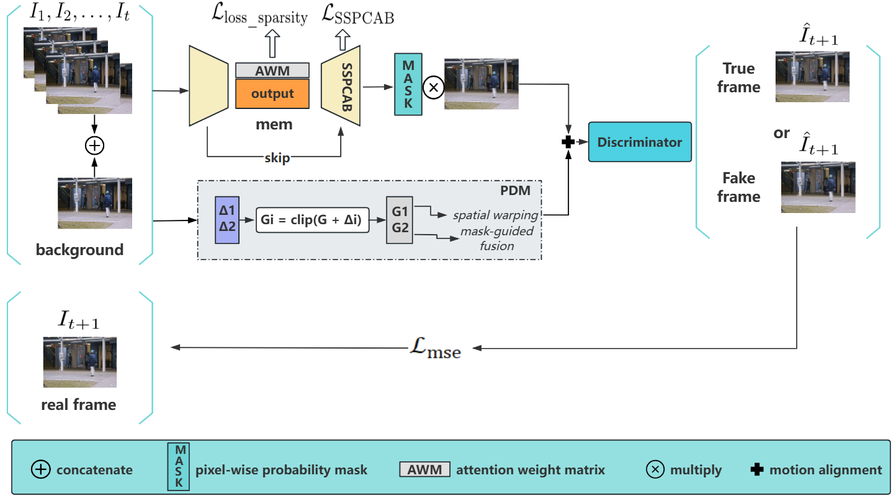

# Normality-Constrained Collaborative Adversarial Learning for Video Anomaly Detection

Official PyTorch implementation of **Normality-Constrained Collaborative Adversarial Learning for Video Anomaly Detection**.

This repository provides the experimental code for video anomaly detection on **UCSD Ped2**, **CUHK Avenue**, and **ShanghaiTech**. The method follows a future-frame prediction paradigm: given consecutive historical frames, the model predicts the next frame and detects abnormal events according to the prediction discrepancy between the generated frame and the real future frame.

## Overview

The proposed framework, named **NC-CAL**, integrates multiple complementary modules for robust anomaly detection:

- **GAN-based adversarial learning** for improving the realism and temporal consistency of predicted frames.
- **Memory module** for storing compact normal prototypes and suppressing abnormal reconstruction.
- **SSPCAB** for self-supervised global structural modeling through masked convolution and channel attention.
- **PDM** for motion-aware deformation alignment and multi-scale temporal motion modeling.

The whole framework is designed to jointly model spatial structures and temporal dynamics in surveillance videos.



## Project Structure

```text
MMC-AL/
├── Train_ped2_avenue.py                # Training script for UCSD Ped2 and Avenue
├── Evaluate_ped2.py                    # Evaluation script for UCSD Ped2
├── process_avenue.py                   # Obtain the raw anomaly scores of the Avenue dataset
├── Evaluate_avenue.py                  # Evaluation script for CUHK Avenue  
├── Train_shanghai.py                   # Training script for ShanghaiTech
├── Evaluate_shanghai.py                # Evaluation script for ShanghaiTech
├── dataset_utils.py                    # Leakage-free video-level train/validation split
├── losses.py                           # BCE adversarial objectives
├── utils.py                            # Background and anomaly-score utilities
│
├── model/                              # Model definition directory
│   ├── final_future_prediction_ped2.py       # Future-frame prediction model for Ped2
│   ├── final_future_prediction_avenue.py     # Future-frame prediction model for Avenue
│   ├── final_future_prediction_shanghai.py   # Future-frame prediction model for ShanghaiTech
│   ├── unet.py                               # U-Net encoder-decoder architecture
│   ├── mem.py                                # Memory module
│   ├── pix2pix_networks.py                   # Pix2Pix generator/discriminator networks
│   └── sspcab_torch.py                       # SSPCAB self-supervised prediction module
│
├── data/                               # Frame-level labels used during evaluation
│   ├── frame_labels_ped2.npy           # Frame-level labels for UCSD Ped2
│   ├── frame_labels_avenue.npy         # Frame-level labels for CUHK Avenue
│   └── frame_labels_shanghai.npy       # Frame-level labels for ShanghaiTech
│
└── bkg_ped2.jpg                        # Fixed Ped2 background template
```

## Environment

The code was tested with the following environment:

```text
Python 3.8.19
PyTorch 2.4.1 + CUDA 12.4
TorchVision 0.19.1 + CUDA 12.4
OpenCV-Python 4.10.0.84
NumPy 1.21.5
```

A CUDA-enabled GPU is recommended. Some scripts use `.cuda()` directly, so CPU-only execution may require manually changing device-related code.

### Installation

```bash
conda create -n MMC python=3.8.19 -y
conda activate MMC

# Install PyTorch according to your CUDA version.
# Example for CUDA 12.4:
pip install torch==2.4.1 torchvision==0.19.1 --index-url https://download.pytorch.org/whl/cu124

# Install other dependencies from the repository root
pip install -r requirements.txt
```

If your CUDA version is different, please install the corresponding PyTorch build from the official PyTorch installation guide.

## Dataset Preparation

This repository supports three commonly used video anomaly detection datasets:

- **UCSD Ped2**
- **CUHK Avenue**
- **ShanghaiTech**

If you need to download a dataset, these resources may be helpful:
* USCD Ped2 [[Dataset](http://www.svcl.ucsd.edu/projects/anomaly/UCSD_Anomaly_Dataset.tar.gz)]
* CUHK Avenue [[Dataset](http://www.cse.cuhk.edu.hk/leojia/projects/detectabnormal/Avenue_Dataset.zip)]
* ShanghaiTech [[Dataset](https://github.com/StevenLiuWen/ano_pred_cvpr2018)]
* Other files: 
Link: https://pan.baidu.com/s/14gZ8UfKyo4uiRua_8RIoBg?pwd=rb6r
Please download the datasets from their official sources and organize the extracted frames as follows:

```text
data/
├── datasets/
│   ├── ped2/
│   │   ├── training/frames/
│   │   │   ├── 01/*.jpg
│   │   │   └── ...
│   │   └── testing/frames/
│   │       ├── 01/*.jpg
│   │       └── ...
│   │
│   ├── avenue/
│   │   ├── training/frames/
│   │   └── testing/frames/
│   │
│   └── shanghai/
│       ├── training/frames/
    │       ├── testing/frames/
    │       └── testing/test_frame_mask/
│
├── frame_labels_ped2.npy
├── frame_labels_avenue.npy
└── frame_labels_shanghai.npy
```


## Training

Run all commands from the `MMC-AL` directory. The paper configuration is used
by default for every dataset: RGB input, batch size 8, 60 epochs, 6 Phase-1
epochs, adversarial weight 0.5, a 2,000-item memory bank with 512-dimensional
prototypes, and a memory sparsity weight of 0.002.

```bash
cd MMC-AL
```

### UCSD Ped2 

```bash
python Train_ped2_avenue.py --dataset_type ped2 --dataset_path /path/to/ped2
```


### CUHK Avenue

```bash
python Train_ped2_avenue.py --dataset_type avenue --dataset_path /path/to/avenue
```


### ShanghaiTech

```bash
python Train_shanghai.py --dataset_path /path/to/shanghai
```

ShanghaiTech background templates are generated locally on the first training
or evaluation run from the corresponding frame split. The generated `bkg/`
and `bkg_/` directories are ignored by Git and must not be uploaded.

### Leakage-free model selection

The training scripts never read the official testing split or its anomaly
labels. By default, 20% of the normal training videos are held out at the
video level (`--val_fraction 0.2 --split_seed 2021`). The checkpoint with the
lowest future-frame prediction MSE on this normal-only validation subset is
selected, with optional early stopping controlled by
`--early_stop_patience`. Run the corresponding `Evaluate_*.py` script only
after training to report the official test AUC once.

For a fixed-epoch protocol, pass `--skip_validation`. In that mode all normal
training videos are used and the final epoch is saved; the test set is still
not evaluated during training. ShanghaiTech test-video background templates
are loaded only by `Evaluate_shanghai.py`, never by `Train_shanghai.py`.


## Evaluation

### UCSD Ped2

```bash
python Evaluate_ped2.py --dataset_path /path/to/ped2 \
  --model_dir ./exp/ped2/log/bool_ped2.pth
```

### CUHK Avenue

```bash
python Evaluate_avenue.py --dataset_path /path/to/avenue \
  --model_dir ./exp/avenue/log/bool_ped2.pth
```

### ShanghaiTech

```bash
python Evaluate_shanghai.py --dataset_path /path/to/shanghai \
  --model_dir ./exp/shanghai/log/new_shanghai.pth
```

## Checkpoints

The paper-consistent implementation uses a unified U-Net + Memory + SSPCAB +
PDM generator for all three datasets. Older ShanghaiTech checkpoints produced
by the previous VQ/WavePooling/PPA implementation are not architecture-compatible
with this version and must not be used to reproduce the reported method. Train
new checkpoints with the commands above. Large checkpoint files are excluded
from Git; publish newly trained weights through GitHub Releases or an external
download link instead of committing them to the repository.

## Method Pipeline

The core workflow of this repository is:

1. Convert videos into frame sequences.
2. Use several consecutive frames as input and predict the next future frame.
3. Enhance future-frame prediction with memory-augmented representation, SSPCAB structural learning, PDM motion alignment, and adversarial training.
4. Compute anomaly scores according to the discrepancy between predicted frames and real future frames.
5. Evaluate the detection performance using frame-level ROC-AUC.


## Acknowledgement

This implementation is developed for research on unsupervised video anomaly detection. The project is built upon future-frame prediction, adversarial learning, memory-augmented modeling, self-supervised structural prediction, and motion-aware deformation alignment.
